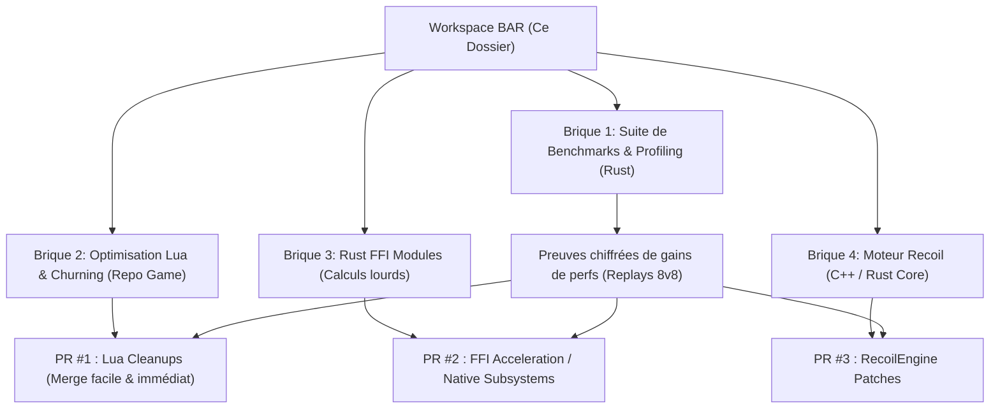

# Beyond All Reason (BAR) - Performance & Architecture Overhaul

Ce document détaille la stratégie technique pour développer des optimisations de performances massives (CPU/RAM/Sim-Lag) sur **Beyond All Reason** et son moteur **Recoil**, avec pour objectif final la **publication, la validation par benchmarks et la soumission de Pull Requests (PRs) pour adoption officielle**.

---

## 1. Diagnostic : Pourquoi le Sim-Lag (30s behind) survient ?

### A. Modèle Lockstep Déterministe
* **Principe** : Le serveur ne calcule ni la physique ni l'IA. Il ordonnance uniquement les paquets d'ordres par frame (30 ticks/s).
* **Conséquence** : Chaque PC client calcule **100% de la simulation**.
* **Le point de rupture** : Si le CPU met plus de 33ms à simuler une frame (cas classique en fin de partie 8v8 avec 4000+ unités en combat), le client n'arrive plus à suivre le temps réel. Il accumule un retard croissant ("Catching up to frame X...").

### B. Les Goulots d'Étranglement Identifiés
1. **Pathfinding & Collisions (Moteur C++)** : 
   - QTPFS (QuadTree PathFinding) subit des pics de calculs exponentiels lors des collisions de masse et passages étroits.
2. **Lua Churning & Garbage Collection (Simulation & UI)** :
   - Des milliers d'appels `GameFrame` et `UnitDamaged` par seconde.
   - Création continue de tables temporaires en Lua générant des pauses de Garbage Collection (GC pauses).
3. **Mono-threading de la boucle de simulation critique** :
   - La simulation doit être 100% déterministe entre différentes architectures de processeurs (Intel, AMD, ARM). Paralléliser sans introduire de désynchronisation (Desync) est le défi central.

---

## 2. Stratégie de Fork & Soumission Upstream (Merge Strategy)

Pour qu'un projet open source de cette envergure accepte nos contributions, **il ne faut pas arriver avec un monolithe impossible à relire**, mais avec une série de briques modulaires, documentées et chiffrées :

---

## 3. Plan de Développement Détaillé

### Étape 1 : Outillage de Diagnostic & Benchmarks (`tools/bar-profiler`)
* Développer un parseur et analyseur de replays (`.sdfz`) en Rust pour mesurer avec précision :
  - La durée de chaque tick de simulation.
  - Les frames critiques responsables des décrochages de vitesse.
  - L'évolution de l'empreinte RAM au cours de la partie.
* **Bénéfice** : Fournir aux mainteneurs de BAR des métriques concrètes avant / après chaque patch.

### Étape 2 : Optimisations Lua dans le Game Repo (`Beyond-All-Reason`)
* Audit des gadgets les plus consommateurs dans `luarules/gadgets/`.
* Élimination du table-churning (réutilisation de buffers / tables poolées pour supprimer les pauses GC).
* Mise en cache spatiale des requêtes `GetUnitsInSphere` / `GetUnitsInCylinder`.

### Étape 3 : Module Natif Rust FFI (`crates/bar-perf-core`)
* Développement d'une bibliothèque dynamique native compilée en Rust avec ABI C (`cdylib`).
* Liaison avec LuaJIT via `ffi.C`.
* Cibles prioritaires :
  - Calcul de champs de potentiel (Flow fields) avec vectorisation SIMD (AVX2/NEON).
  - Algorithmes de clustering de cibles et de formation d'armées.

### Étape 4 : Serveur & Autohost
* Remplacement / alternative au script Perl de SPADS par un démon léger et asynchrone en Rust pour les serveurs dédiés.

---

## 4. Règles d'Or pour le Succès du Merge

1. **Déterminisme Absolu** : Aucun flottant non déterministe ou race-condition dans la partie `Synced`. Zéro Desync.
2. **Modularité** : Chaque modification doit pouvoir être activée/désactivée via un flag ou une option de configuration.
3. **Cross-platform** : Compatibilité garantie Windows (MSVC) et Linux (GCC/Clang).
