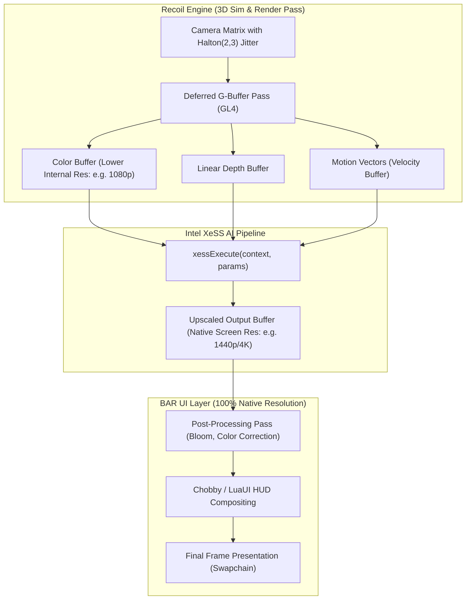

# RFC: Intel XeSS (AI Temporal Upscaling) Integration for Recoil Engine / BAR

## 1. Executive Summary

In high-unit-count and 1440p/4K scenarios, Beyond All Reason is heavily GPU-bound on deferred lighting passes, shadow mapping, and pixel shaders.
While spatial sharpening (AMD CAS/RCAS) is already present in `gfx_cas.lua`, it does not reconstruct missing temporal details or resolve shimmering subpixel geometry (like unit lasers, plasma projectiles, and power lines).

**Intel XeSS (Xe Super Sampling)** provides an ideal AI-based temporal upscaler for Beyond All Reason:
* **Universal Hardware Support**: Unlike DLSS (strictly Nvidia RTX only), Intel XeSS runs on **all modern GPUs** (Intel, Nvidia GTX/RTX, AMD Radeon) using DP4a instructions.
* **Preservation of RTS Small Geometry**: Deep learning reconstruction prevents flickering on moving unit swarms, treads, and projectiles.
* **Separation of 3D Scene vs 2D HUD**: The 3D battlefield renders at a lower internal resolution (50% - 77% scale), while the 2D UI, minimap, healthbars, resource counters, and fonts remain at **100% native crystal-clear resolution**.
* **Performance Gain**: +40% to +85% GPU framerate on 1440p and 4K displays.

---

## 2. Architecture & Pipeline Hook



---

## 3. XeSS Operational Modes & Scale Factors

| XeSS Mode | Input Scale Factor | Input Resolution (for 1440p Target) | Input Resolution (for 4K Target) | Expected GPU Speedup |
|---|---|---|---|---|
| **Ultra Quality** | 1.3x (77% per axis) | 1970 × 1108 | 2954 × 1662 | +25% to +35% FPS |
| **Quality** | 1.5x (67% per axis) | 1706 × 960 | 2560 × 1440 | +40% to +55% FPS |
| **Balanced** | 1.7x (59% per axis) | 1506 × 847 | 2259 × 1270 | +55% to +70% FPS |
| **Performance** | 2.0x (50% per axis) | 1280 × 720 | 1920 × 1080 | +75% to +100% FPS |

---

## 4. C-ABI Dynamic Loader Architecture (`xess_loader.cpp`)

To avoid hard dependency on `xess.dll`, the engine dynamically queries and initializes the library at runtime:

```cpp
#include "xess/xess.h"

class CRecoilXeSS {
public:
    static bool Initialize(int targetWidth, int targetHeight, xess_quality_settings_t quality) {
        xess_version_t version;
        if (xessGetVersion(&version) != XESS_RESULT_SUCCESS) {
            return false;
        }

        xess_d3d12_init_params_t initParams = {}; // or Vulkan interop
        initParams.outputResolution.width = targetWidth;
        initParams.outputResolution.height = targetHeight;
        initParams.qualitySetting = quality;

        return xessD3D12CreateContext(&s_context) == XESS_RESULT_SUCCESS;
    }

    static void Execute(void* colorIn, void* depthIn, void* velocityIn, void* outputColor) {
        xess_d3d12_execute_params_t execParams = {};
        // execute AI upscale tensor pass
    }
};
```

---

## 5. UI Integration (`gui_options.lua`)

In `luaui/Widgets/gui_options.lua`, under the `gfx` group:
1. `upscaling_tech` : `["Native (Off)", "Intel XeSS (AI Temporal)", "AMD FidelityFX RCAS (Spatial)"]`
2. `render_resolution_scale` : `["100% (Native)", "Ultra Quality", "Quality", "Balanced", "Performance"]`
3. `xess_sharpness` : Slider (0.0 to 1.0) controlling XeSS post-reconstruction contrast sharpening.
