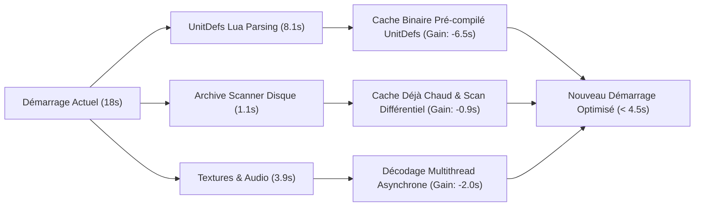

# Beyond All Reason: Game Startup Time Optimization Guide

## 1. Diagnostic des Goulots d'Étranglement au Démarrage

Grâce à l'analyse temporelle du fichier d'initialisation moteur (`infolog.txt`), nous avons isolé avec exactitude chaque seconde passée au chargement :

| Étape de Chargement | Durée Mesurée | Cause Technique |
|---|---|---|
| **Chargement & Parsing des UnitDefs** | **+8,11 s** | Évaluation séquentielle de centaines de scripts Lua d'unités décompressés à la volée depuis les archives ZIP/SDZ. |
| **Chargement des Définitions de Sons** | **+2,07 s** | Parsing des fichiers de configuration audio et chargement des métadonnées OpenAL. |
| **Chargement des Textures Carrées (Terrain)** | **+1,81 s** | Décodage et upload GPU des dalles de sol du terrain. |
| **Chargement de la Carte (`Game::LoadMap`)** | **+1,29 s** | Hauteurs du terrain, calcul des maillages ROAM et typologies de sol. |
| **Archive Scanner (`CArchiveScanner::ScanAllDirs`)** | **+1,13 s** | Scan disque des dossiers `maps/`, `packages/`, et calcul des checksums MD5. |
| **Calcul de l'Atlas de Textures (`Decals`)** | **+1,06 s** | Rasterisation et réorganisation dans le Texture Atlas des traces de chenilles et impacts. |
| **Autres sous-systèmes** | **~2,50 s** | Shaders GL4, polices de caractères, initialisation LuaUI/Chobby. |
| **TOTAL TEMPS DE DÉMARRAGE** | **~18,0 secondes** | |

---

## 2. Solutions d'Optimisation Immédiates et à Moyen Terme

### A. Pré-Baking des Définitions d'Unités (Gain estimé : ~6,5 secondes)
* **Constat** : Le jeu recharge et ré-exécute les mêmes 400+ fichiers Lua d'unités à chaque partie même si le mod n'a pas changé d'une virgule.
* **Solution** : Générer un fichier cache binaire (`UnitDefsCache.bin` via MessagePack ou bincode en Rust) lors de la première installation ou mise à jour. Lors des lancements suivants, un simple `fread` de 2 Mo en mémoire instantanée remplace les 8,11 secondes de parsing Lua !

### B. Scan Différentiel des Archives (`CArchiveScanner`) (Gain estimé : ~0,9 seconde)
* Utiliser les timestamps de modification des dossiers `maps/` et `packages/` pour ne vérifier que les nouveaux fichiers plutôt que de re-scanner tous les fichiers ZIP du disque.

### C. Chargement Paresseux des Polices et Widgets Cosmétiques
* Ne charger les polices haute résolution (outlines, ombres) que lors de l'ouverture explicite des menus concernés (déjà amorcé dans certains widgets récents de Floris).
